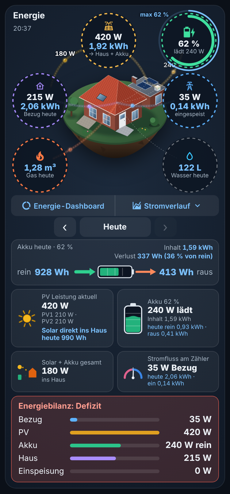
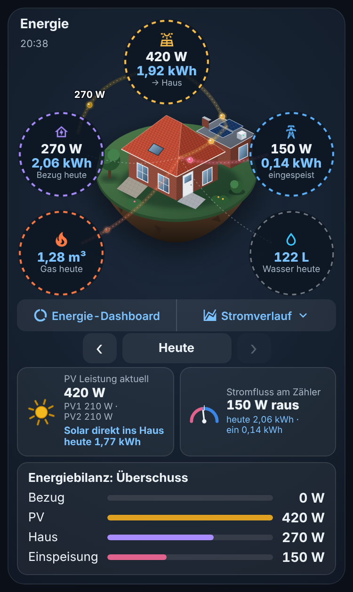
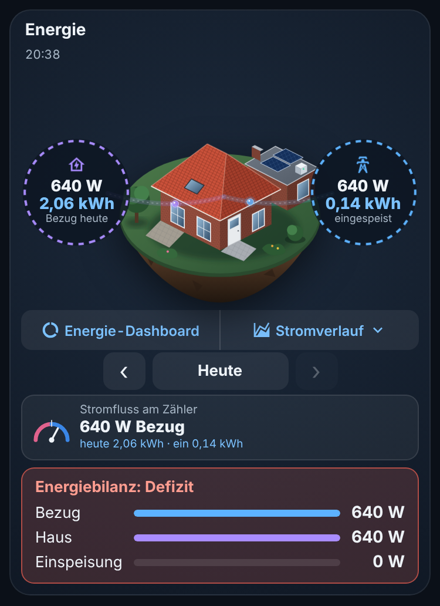
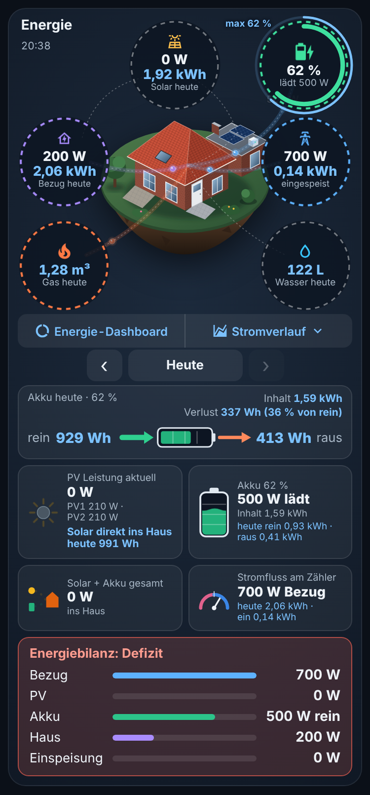
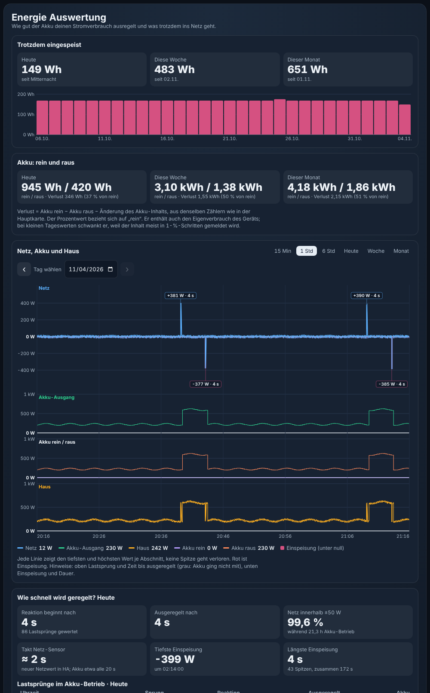

# Energie Dashboard Card

[](https://github.com/hacs/integration)
[](https://github.com/tlangfe/energie-dashboard/actions/workflows/validate.yml)


[English](README.md) · **Deutsch**

Eine kompakte, dunkle Lovelace-Karte für Home Assistant: Dein Haus schwebt als Insel in der Mitte, rundherum stehen Solar, Akku, Haus, Netz, Gas und Wasser, und ruhige Blasen zeigen, wohin der Strom gerade fließt. Darunter folgen Tageswerte, Akku-Bilanz, Stromverlauf und Energiebilanz.



*Vorschau: gezeichnetes Beispielhaus mit Beispielwerten.*

## Funktionen

- **Live und Tageswerte zugleich:** Leistung in Watt (weiß) und Energie des Tages (blau), mit Tagesauswahl ‹ Heute › für frühere Tage.
- **Richtige Flüsse:** Solar → Haus, Solar → Akku, Solar → Netz, Akku → Haus, Akku → Netz, Netz → Haus und Netz → Akku werden aus nur drei Leistungen berechnet (Netz, Solar, Akku). Du brauchst keine Template-Sensoren und keine Riemann-Helfer.
- **Einrichtung ohne YAML:** Die Karte liest die Energie-Einstellungen von Home Assistant und schlägt passende Sensoren vor. Eine Prüfliste im Editor zeigt, welcher Sensor wo erscheint und ob er funktioniert.
- **Jeder Sensor bleibt frei wählbar:** Liegt die Erkennung daneben, wählst du den richtigen Sensor einfach im Editor aus.
- **Alle Ausstattungen:** mit oder ohne Solar, Akku, Gas und Wasser, oder nur Netz.
- **Dein eigenes Haus:** Bild hochladen (es wird in den HA-Medien gespeichert), Form, Größe, Position und Ankerpunkte einstellen.
- **Ruhige Animation:** Pro Linie läuft genau eine langsame Blase, die Geschwindigkeit hängt von der Leistung ab. `prefers-reduced-motion` wird beachtet.
- **Deutsch und Englisch,** Zahlen und Uhrzeiten im passenden Format.
- **Eine einzige Datei** ohne Abhängigkeiten, mit zwei Karten: der Hauptkarte und der [Energie Auswertung (Pro)](#energie-auswertung-pro).
- **Ausprobieren ohne eigenes HA** in [GitHub Codespaces](#ausprobieren-ohne-eigenes-home-assistant-github-codespaces).

## Installation

### Über HACS (empfohlen)

[](https://my.home-assistant.io/redirect/hacs_repository/?owner=tlangfe&repository=energie-dashboard&category=plugin)

1. Auf den Knopf oben klicken, oder in HACS oben rechts ⋮ › **Benutzerdefinierte Repositories** wählen, `https://github.com/tlangfe/energie-dashboard` eintragen und als Typ **Dashboard** wählen.
2. **Energie Dashboard Card** öffnen und **Herunterladen** wählen. Für Vorab-Versionen vorher unter ⋮ › **Neu herunterladen** die Option **Beta-Versionen anzeigen** einschalten.
3. Die Browserseite neu laden. HACS trägt die Ressource selbst ein, ein Neustart von Home Assistant ist nicht nötig.

### Manuell

1. `dist/energie-dashboard-card.js` aus dem [neuesten Release](https://github.com/tlangfe/energie-dashboard/releases) nach `/config/www/` kopieren.
2. **Einstellungen › Dashboards › ⋮ › Ressourcen › Ressource hinzufügen**: URL `/local/energie-dashboard-card.js?v=1.0.0-beta.2`, Typ **JavaScript-Modul**.
3. Die Browserseite neu laden. Bei jedem Update die Zahl hinter `?v=` erhöhen, damit Browser und App die neue Datei laden.

## Ersteinrichtung

1. Dashboard bearbeiten › **Karte hinzufügen** › **Energie Dashboard Card** suchen.
2. Die Karte erkennt ihre Sensoren dabei selbst aus **Einstellungen › Dashboards › Energie**.
3. Im Editor die **Prüfliste** ansehen:
   - ✓ in Ordnung
   - ✗ fehlt oder existiert nicht
   - ⚠ liefert gerade keine Zahl, falsche Einheit oder keine Langzeitstatistik (dann bleibt der Tageswert leer)
4. Falsche oder fehlende Sensoren in den aufklappbaren Bereichen **Strom, Solar, Akku, Gas, Wasser** auswählen. Unter jedem Feld steht, wo der Wert auf der Karte erscheint.
5. Unter **Was ist vorhanden** ausschalten, was du nicht hast (Solar, Akku, Gas, Wasser).
6. Optional unter **Hausbild** ein eigenes Bild hochladen und die Ankerpunkte einstellen.

**Die Erkennung findet nichts?** Das passiert, wenn die Energie-Einstellungen leer sind. Dann entweder dort Netz, Solar, Akku, Gas und Wasser eintragen und danach **Sensoren automatisch erkennen** drücken, oder die Sensoren direkt im Editor auswählen. Die Erkennung sucht fehlende Leistungssensoren nur im **selben Gerät** wie die Zähler und rät nie fremde Sensoren, also zum Beispiel keinen Handy-Akku. Ihr Ergebnis erscheint als Vorschlag und wird erst nach **Vorschlag übernehmen** eingetragen.

## Sensoren und wo sie erscheinen

Du brauchst nur Grundsensoren, alles andere berechnet die Karte. Einheiten werden umgerechnet (W/kW, Wh/kWh/MWh, m³/L).

| Option | Pflicht | Einheit | Erscheint auf der Karte |
|---|---|---|---|
| `grid_power` oder `grid_import_power` + `grid_export_power` | ja | W/kW | Netz-Kreis, Zähler-Kachel, Energiebilanz, Verlauf |
| `grid_invert` | nein | – | Vorzeichen umdrehen (intern + Bezug, − Einspeisung) |
| `grid_import_energy` | empfohlen | kWh | Haus-Kreis: Bezug heute, Zähler-Kachel |
| `grid_export_energy` | empfohlen | kWh | Netz-Kreis: eingespeist, Zähler-Kachel |
| `home_power` | nein | W/kW | Haus-Kreis, Energiebilanz; ohne Sensor wird er berechnet |
| `solar_power` | mit Solar | W/kW | Solar-Kreis, PV-Kachel, Energiebilanz, Verlauf |
| `solar_energy` | mit Solar | kWh | Solar-Kreis: heute, „Solar direkt ins Haus“ |
| `solar_strings` | nein | W/kW | Zeile unter der PV-Leistung, z. B. PV1 · PV2 |
| `battery_power` (+ `battery_invert`) oder `battery_charge_power` + `battery_discharge_power` | mit Akku | W/kW | Akku-Kreis, Akku-Linien, Akku-Kachel |
| `battery_soc` | mit Akku | % | Akku-Kreis (Bogen), Symbole, Tageshöchststand (blauer Ring) |
| `battery_capacity` | empfohlen | kWh | Inhalt und Verlust, wenn `battery_content` fehlt |
| `battery_content` | nein | kWh | Inhalt |
| `battery_energy_in`, `battery_energy_out` | empfohlen | kWh | Akku-Grafik rein/raus, Verlust, „Solar direkt ins Haus“ |
| `gas_energy` | mit Gas | m³/kWh | Gas-Kreis: heute |
| `gas_rate` | nein | beliebig | Gas-Blase läuft, solange der Wert größer 0 ist |
| `water_energy` | mit Wasser | m³/L | Wasser-Kreis: heute in Litern |
| `water_rate` | nein | beliebig | Wasser-Blase läuft, solange der Wert größer 0 ist |

**Vorzeichen:** `grid_power` ist positiv beim Bezug und negativ bei der Einspeisung. `battery_power` ist positiv beim Entladen und negativ beim Laden. Das entspricht den Energie-Einstellungen von Home Assistant. Meldet dein Gerät es andersherum, schaltest du **Vorzeichen umdrehen** ein.

Antippen eines Werts öffnet seinen Verlauf.

## Varianten

| Ausstattung | Was du siehst |
|---|---|
| Solar + Akku | alles |
| Nur Solar | ohne Akku-Kreis, Akku-Linien, Akku-Grafik, Akku-Kachel und „Solar + Akku gesamt“ |
| Nur Akku | ohne Solar-Kreis, Solar-Linien und PV-Kachel |
| Nur Netz | Haus, Netz, Zähler-Kachel und Energiebilanz |
| Ohne Gas und Wasser | Kreise und Linien fehlen, die Zeichenfläche wird unten kürzer |
| Akku lädt aus dem Netz | blaue Linie Netz → Haus → Akku, nicht als Solar dargestellt |

  

## Eigenes Hausbild

Im Editor unter **Hausbild**:

- **Bild hochladen (in Medien speichern):** Die Datei landet unter **Medien › Lokale Medien** und wird als `media-source://media_source/local/<Datei>` eingetragen. Die Karte holt sich dafür eine signierte Adresse, so funktioniert es auch in der App und von unterwegs.
- **Bild aus Medien wählen:** Liste der Bilder in den lokalen Medien.
- **Bildpfad:** zum Beispiel `/local/haus.png` (Datei in `/config/www/`) oder eine `https://`-Adresse.
- **Form:** `frei` für freigestellte PNG/WebP ohne Hintergrund (sieht am besten aus), `rund` schneidet ein normales Foto kreisrund zu.
- **Größe und Position** mit Schiebereglern, die Vorschau aktualisiert sich sofort.
- **Ankerpunkte** in Prozent des Bilds: **Solarmodule**, **Akku** und **Hausmitte**. Die Flusslinien laufen zu diesen Punkten.
- **Beispielhaus verwenden** setzt Bild und Ankerpunkte zurück.

Kann das Bild nicht geladen werden, zeigt die Karte die Beispielzeichnung und einen Hinweis.

## YAML-Beispiele

YAML ist optional, der Editor schreibt dasselbe.

Solar mit Akku:

```yaml
type: custom:energie-dashboard-card
grid_power: sensor.grid_power
grid_import_energy: sensor.grid_import
grid_export_energy: sensor.grid_export
solar_power: sensor.solar_power
solar_energy: sensor.solar_energy
solar_strings:
  - entity: sensor.pv1_power
    name: Süd
  - entity: sensor.pv2_power
    name: West
battery_charge_power: sensor.battery_charge_power
battery_discharge_power: sensor.battery_discharge_power
battery_soc: sensor.battery_soc
battery_capacity: 2.56
battery_energy_in: sensor.battery_in
battery_energy_out: sensor.battery_out
gas_energy: sensor.gas_meter
water_energy: sensor.water_meter
```

Nur Solar, ohne Gas und Wasser, eigenes Foto rund zugeschnitten:

```yaml
type: custom:energie-dashboard-card
show_battery: false
show_gas: false
show_water: false
grid_power: sensor.grid_power
grid_invert: true
solar_power: sensor.inverter_power
solar_energy: sensor.inverter_energy_total
image: media-source://media_source/local/haus.jpg
image_shape: circle
image_size: 50
anchor_solar_x: 40
anchor_solar_y: 30
anchor_home_x: 50
anchor_home_y: 60
```

Weitere Optionen: `title`, `language` (`auto`, `de`, `en`), `max_width` (Standard 420), `dashboard_link` (Standard `/energy`), `dashboard_link_text`, `image_x`, `image_y`, `anchor_battery_x`, `anchor_battery_y`, `solar_max`, `grid_max`.

## Energie Auswertung (Pro)

Die zweite Karte `custom:energie-dashboard-auswertung-card` steckt in derselben Datei, eine Ressource reicht für beide. Sie ist für einen eigenen Dashboard-Tab gedacht (Ansichtstyp **Panel** empfohlen).



*Vorschau mit Beispielwerten.*

**Was sie zeigt:**
- Einspeisung heute, diese Woche, diesen Monat und als Balken für 30 Tage
- Akku rein/raus und Verlust (gleiche Rechnung wie in der Hauptkarte, Prozent von „rein“)
- Verlauf von Netz, Akku-Ausgang, Akku rein/raus und Haus mit Nulllinien, auch für einen gewählten Tag (Kalender) und als Woche/Monat
- Regelverhalten: Reaktionszeit und Ausregelzeit nach Lastsprüngen, Anteil der Zeit im Toleranzband, Einspeise-Spitzen mit Dauer
- Tagestabelle; auf dem Handy seitlich wischbar, die erste Spalte bleibt stehen

**Einrichtung:** genau wie bei der Hauptkarte. Karte hinzufügen, die Sensoren werden aus den Energie-Einstellungen vorgeschlagen, jeder Sensor ist im Editor frei wählbar, und die Prüfliste zeigt, was funktioniert. Zusätzlich gibt es im Editor den Bereich **Auswertung und Speichern**.

**Bitte vorher lesen, wo die Grenzen liegen:**

| Punkt | Was das bedeutet |
|---|---|
| Speichern nur mit Zustimmung | Mit **Auswertung in Home Assistant speichern** (`store_statistics: true`) speichert die Karte beim Öffnen für jeden abgeschlossenen Tag Auswertungswerte als Langzeitstatistik `energie_auswertung:*`. **Ohne diesen Schalter schreibt sie nichts** in Home Assistant und zeigt nur, was die Rohdaten hergeben. |
| Nicht dauerhaft rückwirkend | Ausgewertet werden nur Tage, für die Home Assistant noch Sekundenwerte hat (`raw_days`, passend zu `recorder: purge_keep_days`, Standard 10). Wird die Karte länger nicht geöffnet, fehlen diese Tage. |
| Schneller Netz-Sensor nötig | Reaktionszeiten sind nur mit etwa einem Netzwert pro Sekunde sinnvoll. Die Karte misst den Takt und blendet Reaktions- und Ausregelzeiten aus, wenn der Sensor seltener liefert (`max_rate_s`, Standard 2,5 s). |
| Nur mit geregeltem Akku | Der Teil „Wie schnell wird geregelt?“ ist nur für Akkus mit Nulleinspeisungs-Regelung sinnvoll. Ohne Akku oder mit `show_regulation: false` bleiben Einspeisung, Akku-Bilanz und Verlauf. |
| Grenzwerte anpassen | `band_w` (Toleranzband, Standard 50 W), `jump_w` (Lastsprung ab, Standard 120 W), `inverter_max_w` (Höchstleistung des Speichers, Standard 800 W). Die „vermutete Ursache“ von Spitzen (`show_cause`) ist nur ein grober Anhaltspunkt und standardmäßig aus. |

**Gespeicherte Werte löschen:** im Karteneditor unter **Gespeicherte Auswertung** › **Gespeicherte Auswertungswerte löschen**, oder unter **Entwicklerwerkzeuge › Statistik** nach „Energie Auswertung“ suchen und die Einträge löschen. Danach den Schalter ausschalten, sonst legt die Karte sie beim nächsten Öffnen neu an.

Beispiel:

```yaml
type: custom:energie-dashboard-auswertung-card
grid_power: sensor.grid_power
grid_import_energy: sensor.grid_import
grid_export_energy: sensor.grid_export
battery_power: sensor.battery_power
battery_soc: sensor.battery_soc
battery_capacity: 2.56
battery_energy_in: sensor.battery_in
battery_energy_out: sensor.battery_out
store_statistics: false   # erst nach bewusster Entscheidung auf true
raw_days: 10
band_w: 50
jump_w: 120
inverter_max_w: 800
```

Weitere Optionen: `start_date` (Auswertung ab, z. B. nach Zählerwechsel), `output_power` (Ausgang, mit dem der Speicher regelt, wenn er sich von der Entladeleistung unterscheidet), `show_cause`, `max_rate_s`, `title`, `language`.

## Ausprobieren ohne eigenes Home Assistant (GitHub Codespaces)

[](https://codespaces.new/tlangfe/Energie-Dashboard?quickstart=1)

1. Auf den Knopf klicken und **Create codespace** wählen (GitHub-Konto nötig; Codespaces hat ein kostenloses Monatskontingent).
2. Warten, bis im Terminal `[energie-test] Fertig.` steht. Home Assistant öffnet sich in einem neuen Tab (sonst: **Ports** › **Home Assistant (8123)** › Globus).
3. Anmelden mit **test** / **test1234** und links **Energie Test** wählen.

**Startet HA nicht?** Im Codespace-Terminal `node .devcontainer/setup.mjs log` eingeben, das zeigt den Grund. Einen alten Codespace unter https://github.com/codespaces löschen und neu anlegen, dann hat er den neuesten Stand.

Der Codespace startet ein Test-Home-Assistant mit Schiebereglern für Solar, Hausverbrauch, Akku, Ladestand, Gas und Wasser, daraus berechneten Sensoren mit passender `device_class` und `state_class`, eingetragenen Energie-Einstellungen, beiden Karten und 48 Stunden Beispiel-Statistik. Alles steht in [`.devcontainer/`](.devcontainer). Lokal funktioniert dasselbe mit VS Code und der Erweiterung „Dev Containers“ (**Reopen in Container**).

## Neue Version zuerst testen, das Original behalten

Die Karte heißt `custom:energie-dashboard-card`. Ältere, selbst gebaute Karten mit anderem Namen laufen daneben weiter.

**Über die Oberfläche (ohne Werkzeug):**

1. **Einstellungen › Dashboards › Dashboard hinzufügen › Neues Dashboard von Grund auf**, Name zum Beispiel „Energie Test“.
2. Dort die Energie Dashboard Card einfügen und einrichten. Dein bisheriges Dashboard bleibt unverändert.
3. Gefällt sie dir: Im Original-Dashboard zuerst über ⋮ › **Rohkonfigurations-Editor** alles kopieren und als Sicherung aufheben, dann die neue Karte neben oder statt der alten einfügen. Die alte Karte und ihre Datei kannst du installiert lassen.

**Mit dem Werkzeug (optional):** `tools/ha-dashboard.mjs` erledigt dieselben Schritte über die WebSocket-API von Home Assistant. Es braucht Node 22 auf einem Rechner deiner Wahl und einen Langzeit-Token. Es installiert nichts und löscht nichts.

```bash
export HA_URL=http://homeassistant.local:8123 HA_TOKEN=<Langzeit-Token>
```

```bash
node tools/ha-dashboard.mjs test
```

```bash
node tools/ha-dashboard.mjs ersetzen --dashboard lovelace
```

```bash
node tools/ha-dashboard.mjs zurueck --dashboard lovelace
```

- `test` legt das Dashboard **Energie Test** an (`/energie-test`) und setzt die neue Karte ein.
- `ersetzen` kopiert zuerst das ganze Dashboard in ein eigenes Sicherungs-Dashboard und eine JSON-Datei und prüft die Kopie. Erst danach ersetzt es die alte Karte (`custom:energie-haus-card`, änderbar mit `--alt`) durch die im Testdashboard eingerichtete neue Karte.
- `zurueck` stellt das Original aus der Sicherung wieder her.

## Fehlerhilfe

- **Ein Tageswert bleibt leer (–):** Der Zähler braucht eine Langzeitstatistik, also `state_class: total_increasing` oder `total` und eine Energie- bzw. Volumeneinheit. Die Prüfliste zeigt das mit ⚠ an. Nach dem Einrichten eines neuen Zählers erscheinen die Werte nach der ersten vollen Stunde.
- **Pfeile laufen falsch herum:** Unter **Strom** bzw. **Akku** die Option **Vorzeichen umdrehen** einschalten.
- **Die Karte zeigt nach einem Update noch die alte Version:** Bei HACS die Seite neu laden (in der App: Einstellungen › Companion App › Debugging › Frontend-Cache leeren). Bei manueller Installation die Zahl hinter `?v=` in der Ressource erhöhen. Die geladene Version steht in der Browser-Konsole: `ENERGIE-DASHBOARD-CARD 1.0.0-beta.2`.
- **„Sensor nicht gefunden“ auf der Karte:** Der eingetragene Sensor existiert nicht (mehr). Im Editor einen anderen wählen.
- **Das eigene Bild fehlt:** Die Karte zeigt dann das Beispielhaus und einen Hinweis. Pfad prüfen oder das Bild erneut hochladen.

## Grenzen der Berechnungen

- **Live-Flüsse** werden aus Netz, Solar und Akku berechnet: Solar versorgt zuerst den Akku (soweit er lädt), dann das Netz (soweit eingespeist wird), der Rest geht ins Haus. Der Akku versorgt zuerst das Netz, soweit dort mehr eingespeist wird, als Solar liefert, der Rest geht ins Haus. Lädt der Akku mehr, als Solar liefert, kommt der Rest aus dem Netz.
- **Tageswerte** = Summe der Stundenstatistik („change“) seit Mitternacht plus der Live-Anteil seit der letzten vollen Stunde. Das funktioniert mit dauerhaft steigenden und mit täglich zurückgesetzten Zählern. Frühere Tage werden zwischen zwei lokalen Mitternächten summiert, die Zeitumstellung ist berücksichtigt.
- **„Solar direkt ins Haus“ (Tag)** = Solar − Akku rein − max(Einspeisung − Akku raus, 0). Das ist eine Näherung: Bei viel eingespeistem Solarstrom fällt sie zu hoch aus, und wenn der Akku aus dem Netz geladen wird, ist sie falsch.
- **Akku-Verlust (Tag)** = Akku rein − Akku raus − Änderung des Inhalts. Die Prozentangabe bezieht sich auf **rein** und ist so beschriftet. Den Inhalt am Tagesanfang liefert das Stundenmittel vor Mitternacht.
- **Nicht mischen:** Geräte-Tageszähler und aus Leistung integrierte Zähler weichen oft 2–10 % voneinander ab. Für zusammengehörende Werte (Solar, Akku rein/raus, Einspeisung) möglichst Zähler aus derselben Quelle wählen, sonst passen die Summen nicht zusammen.

## Versionen

Alle Änderungen stehen im [CHANGELOG](CHANGELOG.md). Releases entstehen automatisch aus Git-Tags (`v1.0.0`). Tags mit Bindestrich (`v1.0.0-beta.2`) erscheinen als Vorab-Version.

## Lizenz

[MIT](LICENSE). Das Beispielhaus ist eine eigene Zeichnung und gehört zum Projekt.
