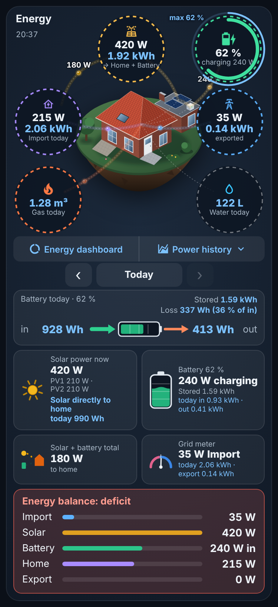
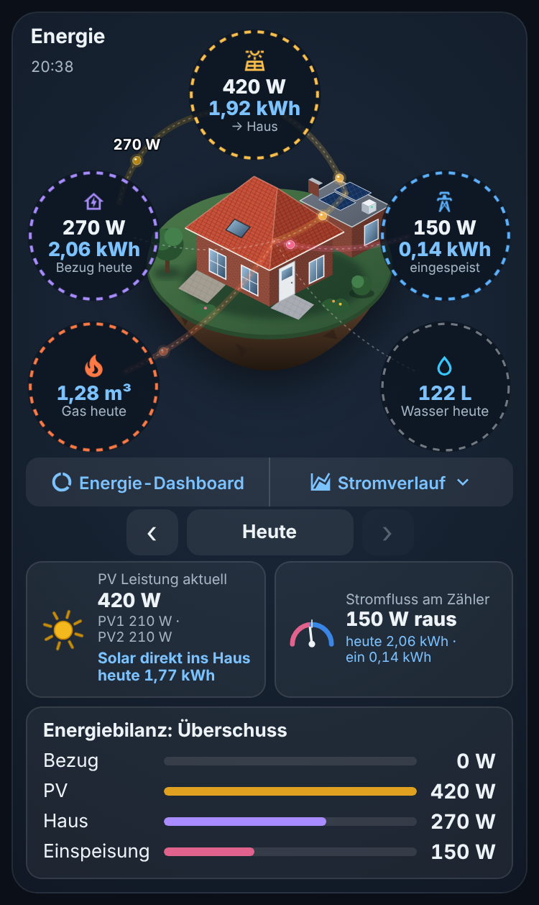
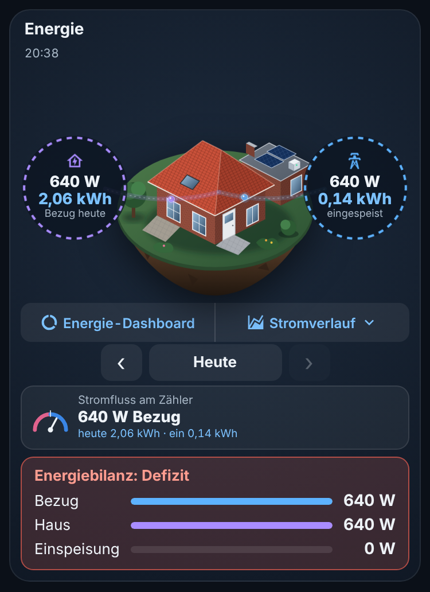
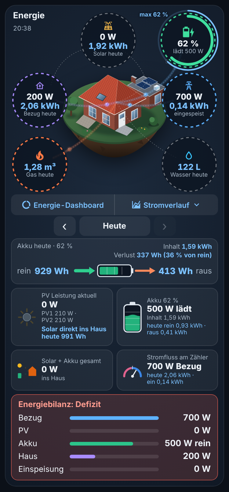

# Energie Dashboard Card

[](https://github.com/hacs/integration)
[](https://github.com/tlangfe/energie-dashboard/actions/workflows/validate.yml)


**English** · [Deutsch](README.de.md)

A compact, dark Lovelace card for Home Assistant. Your house floats as an island in the middle, with circles for solar, battery, home, grid, gas and water around it, and calm bubbles show where the power is flowing right now. Below are daily values, a battery balance, a power history and the energy balance.



*Preview: drawn example house with example values.*

## Features

- **Live and daily values together:** power in watts (white) and today's energy (blue), with a ‹ Today › day selector for past days.
- **Correct flows:** solar → home, solar → battery, solar → grid, battery → home, battery → grid, grid → home and grid → battery are calculated from just three power values (grid, solar, battery). No template sensors or Riemann helpers needed.
- **Setup without YAML:** the card reads the Home Assistant energy settings and suggests sensors. A checklist in the editor shows which sensor appears where and whether it works.
- **Every sensor stays your choice:** if detection picks the wrong one, simply select another in the editor.
- **Any setup:** with or without solar, battery, gas and water, or grid only.
- **Your own house:** upload a picture (stored in Home Assistant media), set shape, size, position and anchor points.
- **Calm animation:** exactly one slow bubble per line, speed depends on the power. Respects `prefers-reduced-motion`.
- **German and English,** numbers and times formatted per language.
- **One single file,** no dependencies.

## Installation

### HACS (recommended)

[](https://my.home-assistant.io/redirect/hacs_repository/?owner=tlangfe&repository=energie-dashboard&category=plugin)

1. Click the button above, or in HACS open ⋮ › **Custom repositories**, add `https://github.com/tlangfe/energie-dashboard` with type **Dashboard**.
2. Open **Energie Dashboard Card** › **Download**. For pre-releases, enable **Show beta versions** under ⋮ › **Redownload** first.
3. Reload the browser page. HACS registers the resource itself, no Home Assistant restart needed.

### Manual

1. Copy `dist/energie-dashboard-card.js` from the [latest release](https://github.com/tlangfe/energie-dashboard/releases) to `/config/www/`.
2. **Settings › Dashboards › ⋮ › Resources › Add resource**: URL `/local/energie-dashboard-card.js?v=1.0.0-beta.1`, type **JavaScript module**.
3. Reload the browser page. Increase the number after `?v=` with every update so browsers and the app load the new file.

## First setup

1. Edit a dashboard › **Add card** › search **Energie Dashboard Card**.
2. The card detects its sensors from **Settings › Dashboards › Energy**.
3. Look at the **checklist** in the editor:
   - ✓ OK
   - ✗ missing or does not exist
   - ⚠ not reporting a number, wrong unit, or no long-term statistics (the daily value stays empty)
4. Pick wrong or missing sensors in the collapsible sections **Power, Solar, Battery, Gas, Water**. Every field tells you where the value appears on the card.
5. Under **What do you have**, turn off what you don't have (solar, battery, gas, water).
6. Optionally upload your own house image under **House image** and set the anchor points.

**Detection finds nothing?** This happens when the energy settings are empty. Either add grid, solar, battery, gas and water there and press **Detect sensors automatically**, or pick the sensors directly in the editor. Missing power sensors are only searched on the **same device** as the meters; foreign sensors (such as a phone battery) are never guessed. The result is shown as a suggestion and is only applied after **Apply suggestion**.

## Sensors and where they appear

Only basic sensors are needed, the card calculates the rest. Units are converted (W/kW, Wh/kWh/MWh, m³/L).

| Option | Required | Unit | Shown on the card |
|---|---|---|---|
| `grid_power` or `grid_import_power` + `grid_export_power` | yes | W/kW | grid circle, grid meter tile, energy balance, history |
| `grid_invert` | no | – | invert sign (internally + import, − export) |
| `grid_import_energy` | recommended | kWh | home circle: import today, grid meter tile |
| `grid_export_energy` | recommended | kWh | grid circle: exported, grid meter tile |
| `home_power` | no | W/kW | home circle, energy balance; calculated if empty |
| `solar_power` | with solar | W/kW | solar circle, solar tile, energy balance, history |
| `solar_energy` | with solar | kWh | solar circle: today, “Solar directly to home” |
| `solar_strings` | no | W/kW | line below solar power, e.g. PV1 · PV2 |
| `battery_power` (+ `battery_invert`) or `battery_charge_power` + `battery_discharge_power` | with battery | W/kW | battery circle, battery lines, battery tile |
| `battery_soc` | with battery | % | battery circle (arc), icons, daily maximum (blue ring) |
| `battery_capacity` | recommended | kWh | stored energy and loss if `battery_content` is missing |
| `battery_content` | no | kWh | stored energy |
| `battery_energy_in`, `battery_energy_out` | recommended | kWh | battery graphic in/out, loss, “Solar directly to home” |
| `gas_energy` | with gas | m³/kWh | gas circle: today |
| `gas_rate` | no | any | gas bubble runs while the value is above 0 |
| `water_energy` | with water | m³/L | water circle: today in litres |
| `water_rate` | no | any | water bubble runs while the value is above 0 |

**Signs:** `grid_power` is positive when importing and negative when exporting. `battery_power` is positive when discharging and negative when charging. This matches the Home Assistant energy settings. If your device reports it the other way round, turn on **Invert sign**.

Tap a value to open its history.

## Variants

| Setup | What you see |
|---|---|
| Solar + battery | everything |
| Solar only | no battery circle, battery lines, battery graphic, battery tile or “Solar + battery total” |
| Battery only | no solar circle, solar lines or solar tile |
| Grid only | home, grid, grid meter tile and energy balance |
| Without gas and water | circles and lines are hidden, the drawing area gets shorter |
| Battery charging from grid | blue line grid → home → battery, not shown as solar |

  

## Your own house image

In the editor under **House image**:

- **Upload image (save to media):** the file is stored under **Media › Local media** and set as `media-source://media_source/local/<file>`. The card requests a signed URL, so it also works in the app and remotely.
- **Pick image from media:** list of images in local media.
- **Image path:** e.g. `/local/house.png` (file in `/config/www/`) or an `https://` URL.
- **Shape:** `free` for cut-out PNG/WebP without background (looks best), `circle` crops a normal photo round.
- **Size and position** with sliders, the preview updates instantly.
- **Anchor points** in percent of the image: **solar panels**, **battery** and **house centre**. The flow lines run to these points.
- **Use example house** resets image and anchor points.

If the image cannot be loaded, the card falls back to the example drawing and shows a note.

## YAML examples

YAML is optional; the editor writes the same.

```yaml
type: custom:energie-dashboard-card
grid_power: sensor.grid_power
grid_import_energy: sensor.grid_import
grid_export_energy: sensor.grid_export
solar_power: sensor.solar_power
solar_energy: sensor.solar_energy
solar_strings:
  - entity: sensor.pv1_power
    name: South
  - entity: sensor.pv2_power
    name: West
battery_power: sensor.battery_power
battery_soc: sensor.battery_soc
battery_capacity: 5.12
battery_energy_in: sensor.battery_in
battery_energy_out: sensor.battery_out
gas_energy: sensor.gas_meter
water_energy: sensor.water_meter
```

Solar only, no gas or water, own photo cropped round:

```yaml
type: custom:energie-dashboard-card
show_battery: false
show_gas: false
show_water: false
grid_power: sensor.grid_power
grid_invert: true
solar_power: sensor.inverter_power
solar_energy: sensor.inverter_energy_total
image: media-source://media_source/local/house.jpg
image_shape: circle
```

More options: `title`, `language` (`auto`, `de`, `en`), `max_width` (default 420), `dashboard_link` (default `/energy`), `dashboard_link_text`, `image_size`, `image_x`, `image_y`, `anchor_solar_x`, `anchor_solar_y`, `anchor_battery_x`, `anchor_battery_y`, `anchor_home_x`, `anchor_home_y`, `solar_max`, `grid_max`.

## Try a new version first, keep the original

The card is called `custom:energie-dashboard-card`, so older self-made cards with another name keep working next to it. Create a new dashboard (**Settings › Dashboards › Add dashboard**), try the card there, and only then add it to your main dashboard (back up the main dashboard first via ⋮ › **Raw configuration editor**).

Optional helper: `tools/ha-dashboard.mjs` (Node 22, long-lived token) creates a test dashboard, replaces an old card in a dashboard after a verified full backup, and restores it. It installs and deletes nothing. See the German README for details.

## Troubleshooting

- **A daily value stays empty (–):** the meter needs long-term statistics (`state_class: total_increasing` or `total` and an energy/volume unit). The checklist shows this with ⚠. New meters show values after the first full hour.
- **Arrows point the wrong way:** turn on **Invert sign** under **Power** or **Battery**.
- **The card still shows the old version after an update:** reload the page (in the app: Settings › Companion App › Debugging › Reset frontend cache). For manual installs, increase `?v=` in the resource. The loaded version is printed in the browser console: `ENERGIE-DASHBOARD-CARD 1.0.0-beta.1`.
- **“Sensor not found” on the card:** the selected sensor does not exist (any more). Pick another in the editor.
- **Own image missing:** the card shows the example house and a note. Check the path or upload again.

## Limits of the calculations

- **Live flows** come from grid, solar and battery: solar feeds the battery first (as far as it charges), then the grid (as far as power is exported), the rest goes to the home. The battery covers export beyond solar first, the rest goes to the home. If the battery charges more than solar provides, the rest comes from the grid.
- **Daily values** = sum of hourly statistics (“change”) since midnight plus the live part since the last full hour. Works with ever-increasing and daily-resetting meters. Past days are summed between two local midnights (daylight saving aware).
- **“Solar directly to home” (day)** = solar − battery in − max(export − battery out, 0). This is an approximation: too high when a lot of solar is exported, and wrong when the battery charges from the grid.
- **Battery loss (day)** = battery in − battery out − change of stored energy. The percentage is relative to **in** and labelled that way. Start-of-day content is the hourly mean before midnight.
- **Don't mix sources:** device daily counters and meters integrated from power often differ by 2–10 %. Use meters from the same source for values that belong together (solar, battery in/out, export).

## Versions

See the [CHANGELOG](CHANGELOG.md). Releases are created automatically from git tags (`v1.0.0`); tags with a hyphen (`v1.0.0-beta.1`) are published as pre-releases.

## License

[MIT](LICENSE). The example house is an original drawing that belongs to this project.
